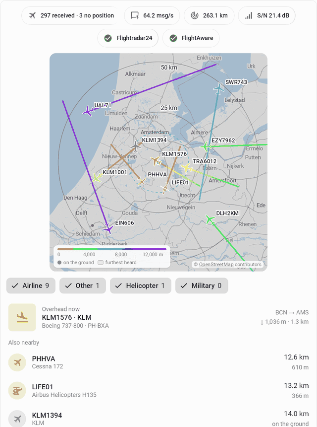
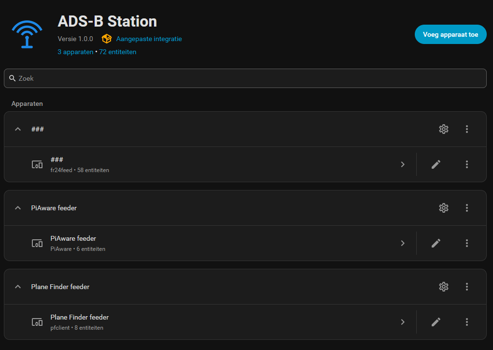

# ADS-B Station for Home Assistant

[](https://github.com/hacs/integration)
[](https://github.com/mirkin-pixel/ha-adsb-station/releases)
[](https://github.com/sponsors/mirkin-pixel)

**See what your own antenna hears, in Home Assistant. No cloud, no account, no API key.**

**Nederlands:** [de documentatie in het Nederlands](docs/nl)

<picture>
  <source media="(prefers-color-scheme: dark)" srcset="docs/images/card-dark.gif">
  
</picture>

ADS-B Station reads the ADS-B receiver you run yourself, on your own network, and keeps working when the internet is down. It does not matter which network you feed, or whether you feed one at all.

## What you get

- **Sensors for your station**: aircraft received, message rate, signal and noise, the closest, highest and fastest aircraft, range records in eight directions, and the feed status of each network.
- **A dashboard card** with a radar or a map, trails, routes and photos, the aircraft nearby and a board of what came over.
- **Events to automate on**: an aircraft about to come over, one on your watchlist, one in distress, a new record.
- **Questions out loud**: ten for Assist, and the same as tools for an AI assistant.
- **Local by default**: routes and photos are the only things fetched from the internet, and only once you switch them on.

## Get started

You need Home Assistant 2025.7 or newer, and a decoder that serves an `aircraft.json` on your network: readsb, dump1090-fa, or the one inside fr24feed.

1. **Install.** Open the repository in the Marketplace (HACS before Home Assistant 2026.11) and click **Download**, then restart when Home Assistant asks.

   [](https://my.home-assistant.io/redirect/hacs_repository/?owner=mirkin-pixel&repository=ha-adsb-station)

2. **Add your station.** Under **Settings → Devices & services → Add integration**, choose **ADS-B Station** and type the address of your receiver. The decoder and the feeders are found for you: one click adds the first, and the others wait under **Discovered** for a click each; see [Configuration](docs/en/configuration.md).
3. **Put the card on a dashboard.** Edit a dashboard, add a card and pick **ADS-B Station**; see [Dashboards](docs/en/dashboards.md).

No Marketplace? Copy `custom_components/adsb_station` into the `custom_components` folder of your configuration and restart.

## What it works with

Anything that serves an `aircraft.json`:

| Decoder | What you get |
|---|---|
| readsb or tar1090, also inside Ultrafeeder | Every receiver entity, and the most of them; see [Which decoder](docs/en/decoders.md) |
| dump1090-fa or SkyAware | Every receiver entity |
| dump1090, dump1090-mutability | The receiver entities its build reports |
| The dump1090 fork bundled with fr24feed | The receiver entities that fork reports |

On top of the decoder it reads the feeders that keep a status page on your network, each as a device of its own:

| Feeder | Network | Status page |
|---|---|---|
| `fr24feed` | Flightradar24 | `:8754/monitor.json` |
| PiAware | FlightAware | `:8080/status.json` |
| `pfclient` | Plane Finder | `:30053/ajax/stats` |



## Documentation

| | |
|---|---|
| [Entities](docs/en/entities.md) | Every entity, what it means and where it comes from |
| [Feeders](docs/en/feeders.md) | What each feeder adds, and where your antenna is blocked |
| [Which decoder](docs/en/decoders.md) | What each decoder can tell you, the aircraft database, and the names this integration ships |
| [Configuration](docs/en/configuration.md) | Setting a station up, its options, and what counts as overhead |
| [Where a flight is going](docs/en/routes.md) | A figure that cannot come off your own network |
| [What it looks like](docs/en/photos.md) | A photo of each aircraft, credited as the photographer asks |
| [When something comes over](docs/en/passages.md) | Passages, the board, and seeing an aircraft coming before it is here |
| [A list worth watching](docs/en/watchlist.md) | Aircraft worth knowing about whenever they turn up |
| [Asking a question](docs/en/services.md) | The actions that answer, with response data |
| [Asking out loud](docs/en/voice.md) | Ten questions for Assist, and tools for AI assistants, answered from your own roof |
| [Dashboards](docs/en/dashboards.md) | The card that comes with the integration, and others to build |
| [Example automations](docs/en/automations.md) | Notifications, announcements and what to trigger on |
| [About the endpoints](docs/en/endpoints.md) | What is read, how often, and what it costs |
| [Troubleshooting](docs/en/troubleshooting.md) | When something is not there, what it cannot do, and removing it |

## Languages

The integration speaks English and Dutch: the entity names and the setup, and the answers it gives out loud. Home Assistant shows English for any other language. A translation is welcome, and the first part of it is a single file to fill in. [Offer one here](https://github.com/mirkin-pixel/ha-adsb-station/issues/new?template=new_language.yml); the issue says what is involved.

## Upgrading

From 1.0 on, an upgrade within the same major version does not break what you built on it: entity IDs and their history, attributes, actions and their responses, and events stay as they are. What exactly is promised is in [CONTRIBUTING.md](CONTRIBUTING.md#what-a-version-number-promises). An update asks for a restart; reload the browser afterwards so the cards are the new ones too.

## Development

Working on the integration itself is covered in [CONTRIBUTING.md](CONTRIBUTING.md). It needs Python 3.14 or newer and nothing else: no Home Assistant installation of your own.

```bash
pip install -r requirements_test.txt
scripts/check.sh          # or scripts\check.ps1
```

## Support

A question or an idea is welcome in [Discussions](https://github.com/mirkin-pixel/ha-adsb-station/discussions), under Q&A or Ideas. Something that does not work goes in an [issue](https://github.com/mirkin-pixel/ha-adsb-station/issues/new?template=bug_report.yml).

If this integration is useful to you, you can [sponsor its development](https://github.com/sponsors/mirkin-pixel) on GitHub. It stays free and complete either way.

This is an unofficial integration and is not affiliated with Flightradar24, FlightAware or Plane Finder. Use at your own risk.
