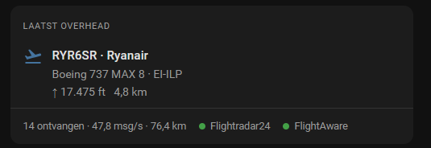

# Dashboards

## The station card

The integration brings a card of its own: the sky around the station, the aircraft overhead with its photo, the others nearby, and how the station is doing. It comes and updates with the integration, so there is nothing to download and nothing to add under **Resources**. After installing or updating, restart Home Assistant and reload the browser once; the card is then in the card picker as **ADS-B Station**.

```yaml
type: custom:adsb-station-card
```



This is the card with photos switched off. With them on, the photo sits above the aircraft's details; it is left out here because a photo from Planespotters may only be shown where it is credited and links back, and a screenshot in this repository would be neither.

That is all it needs. It finds the station's entities by what they are, not by their IDs, so it works whatever language your entities were named in. Everything else can be set in the card editor as well:

| Option | Default | |
|---|---|---|
| `device_id` | the first station with a receiver | Which station, if you read more than one antenna |
| `title` | none | A header above the card |
| `map` | `radar` | The sky around the station: `radar`, `map` for Home Assistant's own map with streets, or `none` |
| `map_scale` | `aircraft` | How far out the radar, or the map, reaches: `aircraft` to fit the aircraft in the sky now, `coverage` to fit the range records as well, or `fixed` |
| `map_range` | `100` | With `map_scale: fixed`, how far out the radar reaches, in kilometres |
| `show_nearby` | `true` | The other aircraft inside the nearby radius, under the one overhead |
| `max_nearby` | `5` | How many of those at most |
| `show_status` | `true` | Aircraft received, message rate, maximum range and signal to noise, and a dot per network for Flightradar24 and FlightAware |

On a wide dashboard the sky sits on the left and the rest beside it; on a phone they are one above the other.

The **Overhead flight** part is the aircraft above you now, or the last one, marked as such, once the sky is empty. With [photos](photos.md) switched on, its photo is shown with the photographer's name under it, and both lead to the photo's page, which is how Planespotters asks for them to be shown. Click the aircraft, a row of the list or a figure of the station for the details of the entity behind it.

### The sky

The radar draws every aircraft the station has a position for, not only the ones nearby: each as the outline of what it is, an airliner, a light aircraft or a helicopter, turned the way it flies, in the colour of its height, with the trail of the last five minutes behind it. Low is warm and high is cool, so an approach stands out from an overflight at a glance; the bar under the radar is the key. The dashed ring is the nearby radius, and the shaded shape is the furthest the station has ever heard an aircraft in each of the eight compass directions: the shape of what your antenna can see, with a dent wherever a roof, a tree or a hill is in the way. It fills out as records are set. Tap an aircraft for its type, registration, height, speed and distance.

The radar is drawn by the card itself, so it needs nothing from outside your network: no map tiles, no account. Its outer ring snaps to the furthest aircraft. With `map_scale: coverage` it takes the range records into account too, so the whole shape stays in view at the cost of smaller aircraft near the station; with `map_scale: fixed` it stays at `map_range`, so the picture never shifts. The aircraft reach the card over a subscription while it is open, and nothing of them is written to the database; the trails exist only in the open browser, and start over when the page is reloaded.

With `map: map` the sky is drawn on Home Assistant's own map instead, with streets and places under it. That map only draws entities and lines, so it shows the trails of every aircraft, and a marker, coloured by height, for the aircraft that have an entity of their own: switch on [Aircraft on the map](#aircraft-on-the-map) for those, and they are the ones inside the nearby radius. Tap a point of a trail for the aircraft's callsign, type, height and distance. The map is zoomed by the same `map_scale` as the radar, and only zoomed again when that scale changes, so you can pan and zoom by hand in between. Its map tiles come from the same place as those of Home Assistant's map card. Where that map cannot be loaded, the card says so and draws the radar instead.

### The station

One line: aircraft received, messages per second, the maximum range, and S/N, how far the signal stands above the noise, which is the figure to watch after changing the gain or the antenna. Click any of them for the entity behind it.

Plane Finder reports no feed status of its own, so it has no dot rather than one that means nothing.

## Aircraft on the map

Switch **Aircraft on the map** on under **Configure** and every aircraft inside the nearby radius gets an entity of its own, drawn where it is, for as long as it is there. Nothing extra is read to do it: the positions are in every poll already, next to the distances the proximity sensors are built on.

A map card shows them all:

```yaml
type: map
geo_location_sources:
  - adsb_station
hours_to_show: 0
```

`hours_to_show: 0` is worth having. Anything higher draws a trail from the recorder, and these entities are not kept there.

By default a marker carries the first letter of each word of the name, so a callsign such as KLM123 is a single K. With `label_mode: icon` it shows what the aircraft is doing instead:

```yaml
type: map
geo_location_sources:
  - source: adsb_station
    label_mode: icon
hours_to_show: 0
```

| Icon | When |
|---|---|
| `mdi:helicopter` | A helicopter, by the category it broadcasts |
| `mdi:shield-airplane` | Military |
| `mdi:airplane-takeoff` | Climbing at 500 feet a minute or more |
| `mdi:airplane-landing` | Descending at 500 feet a minute or more |
| `mdi:airplane` | Everything else, holding its level or saying too little to tell |

What it is goes before what it is doing, so a helicopter climbing out is still a helicopter. The same icon is on the entity everywhere else, in a list or a tile.

That is the trade this option makes, and it is worth understanding before you turn it on. **These aircraft are deliberately not registered.** They exist while they are overhead and are gone the moment they fly on, so a week of traffic leaves nothing behind — no thousands of entities in your registry, no `unavailable` aircraft coming back after every restart, nothing to clean up. In exchange they cannot be renamed, hidden or given an area from the interface, they are not listed under the station's device, and their attributes are kept out of the recorder. Their entity IDs are reused, too: `geo_location.klm123` next week is a different flight under the same name. For history there is the passage board and the [passage event](passages.md), which are built to be kept.

Each aircraft is named after its callsign, or its hex code when it has not sent one yet, and that name is fixed the moment it appears. A callsign often arrives a few polls late, and renaming then would move the entity ID out from under your dashboard halfway through a passage.

How many there are is whatever your radius holds — usually nought to a handful at the default ten kilometres. If you set a wide radius and would rather your database not see them at all, exclude them wholesale:

```yaml
recorder:
  exclude:
    entity_globs:
      - geo_location.*
```

## A board of what came over

The passage board is a list in an attribute, so a markdown card turns it into something to read:

```yaml
type: markdown
content: |
  
  **{{ passage.flight or passage.hex }}** · {{ passage.airline }}
  {{ as_timestamp(passage.at) | timestamp_custom('%H:%M') }} · {{ passage.distance }} km · {{ passage.altitude }} ft
  
```

## Only when it matters

A conditional card keeps the quiet things out of sight until they are not quiet:

```yaml
type: conditional
conditions:
  - condition: state
    entity: binary_sensor.your_station_emergency_squawk
    state: "on"
card:
  type: entities
  entities:
    - binary_sensor.your_station_emergency_squawk
```

The same shape works for **Watchlist in range**, which is off most of the time by design.

## A flag, and a logo if you want one

Two attributes exist to look things up by. `country` is the two-letter code a flag emoji is built out of, and `airline_code` is the three letters a logo file is named after:

```yaml
type: markdown
content: |
  
  
  {{ country | list | map('ord') | map('add', 127397) | map('char') | join }} 
  {{ state_attr(aircraft, 'airline') or state_attr(aircraft, 'hex') }}
```

The flag is built out of the code itself and costs nothing. **An airline logo is a request leaving your network**, which this integration otherwise only does when you switch it on, so that is your call rather than a default: point an image at whichever logo service you are willing to talk to, or drop the files into `www/airline_logos/` and serve them yourself.

## Chips for what is up there

With [Mushroom](https://github.com/piitaya/lovelace-mushroom) installed, a row of template chips reads at a glance. The emitter category is what gives helicopters and drones a chip of their own:

```yaml
type: custom:mushroom-chips-card
chips:
  - type: template
    entity: sensor.your_station_aircraft_nearby
    icon: mdi:airplane
    content: "{{ states('sensor.your_station_aircraft_nearby') }}"
  - type: template
    entity: sensor.your_station_aircraft_nearby
    icon: mdi:helicopter
    content: >
      {{ state_attr('sensor.your_station_aircraft_nearby', 'aircraft')
         | selectattr('category', 'defined')
         | selectattr('category', 'eq', 'A7') | list | count }}
```

## The Flightradar24 card, on your own data

[`Springvar/home-assistant-flightradar24-card`](https://github.com/Springvar/home-assistant-flightradar24-card) is a full interactive card, and it is hard-coded to the attribute names of the FR24 integration. A template sensor turns our `aircraft` attribute into the shape it expects, and then it runs on aircraft your own antenna heard:

```yaml
template:
  - sensor:
      - name: ADS-B for the FR24 card
        state: "{{ state_attr('sensor.your_station_aircraft_nearby', 'aircraft') | count }}"
        attributes:
          flights: >
            
            
              {% set out.flights = out.flights + [{
                'callsign': plane.flight,
                'flight_number': plane.flight,
                'aircraft_registration': plane.registration,
                'aircraft_model': plane.description,
                'aircraft_code': plane.aircraft_type,
                'airline_short': plane.airline,
                'altitude': plane.altitude,
                'ground_speed': plane.speed,
                'vertical_speed': plane.vertical_rate,
                'heading': plane.track,
                'distance_to_tracker': plane.distance,
                'closest_passing_distance': plane.closest_passing_distance,
                'eta_to_closest_distance': plane.seconds_to_closest,
              }] %}
            
            {{ out.flights }}
```

The last two keys are filled in for aircraft that are [coming your way](passages.md#before-it-gets-here) and absent for the rest, which is what the card does with them anyway. The card also wants a position per flight; that means switching the map on, since the aircraft entities are the only place the positions are published.

## Keeping the database out of it

The lists these cards read are attributes, and the heavy ones are already kept out of the recorder by the integration itself. The map entities are the exception worth a rule of your own if you run a wide radius:

```yaml
recorder:
  exclude:
    entity_globs:
      - geo_location.*
```
