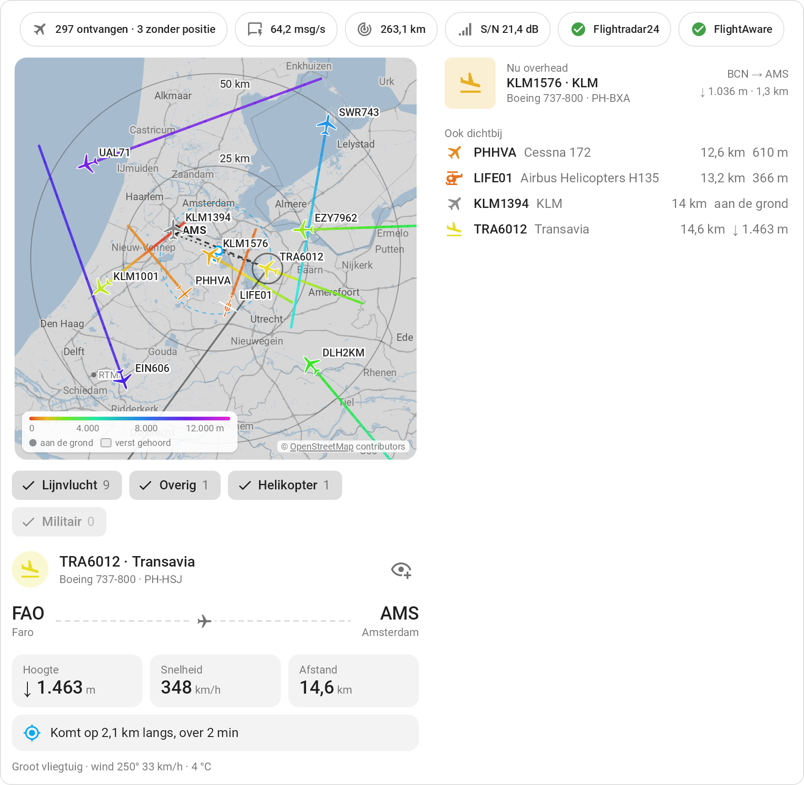

# ADS-B Station voor Home Assistant

**Zie wat je eigen antenne hoort, in Home Assistant. Geen cloud, geen account, geen API-sleutel.**

<picture>
  <source media="(prefers-color-scheme: dark)" srcset="../images/card-map-dark-nl.png">
  
</picture>

ADS-B Station leest de ADS-B-ontvanger uit die je zelf draait, op je eigen netwerk, en blijft werken als het internet eruit ligt. Het maakt niet uit aan welk netwerk je voedt, of aan geen enkel.

## Wat je krijgt

- **Sensoren voor je station**: ontvangen vliegtuigen, berichten per seconde, signaal en ruis, het dichtstbijzijnde, hoogste en snelste vliegtuig, bereikrecords in acht richtingen, en de feedstatus van elk netwerk.
- **Een dashboardkaart** met een radar of een landkaart, sporen, routes en foto's, de vliegtuigen dichtbij en een bord van wat er overkwam.
- **Events om op te automatiseren**: een vliegtuig dat zo overkomt, een van je watchlist, een in nood, een nieuw record.
- **Hardop vragen**: tien voor Assist, en dezelfde als hulpmiddel voor een AI-assistent.
- **Standaard lokaal**: routes en foto's zijn het enige dat van internet komt, en alleen als je ze aanzet.

## Aan de slag

Je hebt Home Assistant 2025.7 of nieuwer nodig, en een decoder die een `aircraft.json` op je netwerk aanbiedt: readsb, dump1090-fa, of die in fr24feed.

1. **Installeren.** Open de repository in de Marktplaats (HACS vóór Home Assistant 2026.11) en klik op **Download**, en herstart als Home Assistant erom vraagt.

   

2. **Je station toevoegen.** Kies onder **Instellingen → Apparaten & diensten → Integratie toevoegen** voor **ADS-B Station**, dan **Deze host doorzoeken op feeders**, en typ het adres van je ontvanger. De `aircraft.json` van de decoder wordt voor je gevonden. Voed je meerdere netwerken? Voeg één entry per feeder toe, met de decoder aan precies één ervan; zie [Configuratie](configuration.md).
3. **De kaart op een dashboard zetten.** Bewerk een dashboard, voeg een kaart toe en kies **ADS-B Station**; zie [Dashboards](dashboards.md).

Geen Marktplaats? Kopieer `custom_components/adsb_station` naar de map `custom_components` van je configuratie en herstart.

## Documentatie

| | |
|---|---|
| [Entiteiten](entities.md) | Elke entiteit, wat hij betekent en waar hij vandaan komt |
| [Feeders](feeders.md) | Wat elke feeder toevoegt, en waar je antenne geblokkeerd zit |
| [Welke decoder](decoders.md) | Wat elke decoder kan vertellen, de vliegtuigdatabase, en de namen die meegeleverd worden |
| [Configuratie](configuration.md) | Een station opzetten, de opties, en wat overhead precies betekent |
| [Waar een vlucht heen gaat](routes.md) | Een gegeven dat niet van je eigen netwerk kan komen |
| [Hoe hij eruitziet](photos.md) | Een foto van elk vliegtuig, met de naam van de fotograaf erbij |
| [Als er iets overkomt](passages.md) | Passages, het bord, en een toestel zien aankomen voordat het er is |
| [Een lijst om in de gaten te houden](watchlist.md) | Toestellen die je wilt weten zodra ze opduiken |
| [Iets vragen](services.md) | De acties die antwoorden, met antwoordgegevens |
| [Hardop vragen](voice.md) | Tien vragen voor Assist, en hulpmiddelen voor AI-assistenten, beantwoord vanaf je eigen dak |
| [Dashboards](dashboards.md) | De kaart die met de integratie meekomt, en andere om te bouwen |
| [Voorbeeldautomatiseringen](automations.md) | Meldingen, aankondigingen en waarop je triggert |
| [Over de endpoints](endpoints.md) | Wat er gelezen wordt, hoe vaak, en wat het kost |
| [Problemen oplossen](troubleshooting.md) | Als er iets niet is, wat hij niet kan, en verwijderen |

## Talen

De integratie spreekt Engels en Nederlands: de namen van de entiteiten en de configuratie, en de antwoorden die hij hardop geeft. Voor elke andere taal toont Home Assistant Engels. Een vertaling is welkom; [bied er hier een aan](https://github.com/mirkin-pixel/ha-adsb-station/issues/new?template=new_language.yml).

## Bijwerken

Vanaf 1.0 breekt een update binnen dezelfde hoofdversie niets van wat je erop gebouwd hebt: entiteits-ID's en hun geschiedenis, attributen, acties en hun antwoorden, en events blijven zoals ze zijn. Wat er precies beloofd wordt, staat in [CONTRIBUTING.md](../../CONTRIBUTING.md#what-a-version-number-promises) (Engels). Een update vraagt om een herstart; ververs daarna de browser, zodat ook de kaarten de nieuwe zijn.
