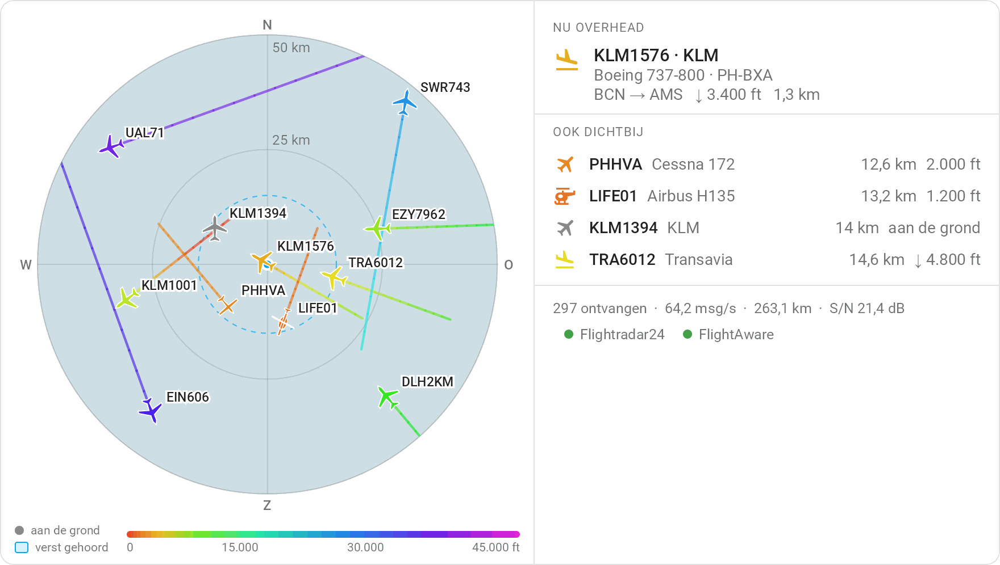

# Dashboards

## De stationskaart

De integratie brengt een eigen kaart mee: de lucht rond het station, het vliegtuig overhead met zijn foto, de andere dichtbij, en hoe het station ervoor staat. Hij komt en wordt bijgewerkt met de integratie, dus er is niets te downloaden en niets toe te voegen onder **Resources**. Herstart Home Assistant na het installeren of bijwerken en ververs de browser één keer; de kaart staat dan in de kaartkiezer als **ADS-B Station**.

```yaml
type: custom:adsb-station-card
```

<picture>
  <source media="(prefers-color-scheme: dark)" srcset="../images/card-radar-dark-nl.png">
  
</picture>

Dit is de kaart met foto's uit. Staan ze aan, dan staat de foto boven de gegevens van het toestel; hier is hij weggelaten, omdat een foto van Planespotters alleen getoond mag worden waar de fotograaf erbij staat en hij terugverwijst, en een screenshot in deze repository is geen van beide.

Meer heeft hij niet nodig. Hij vindt de entiteiten van het station aan wat ze zijn, niet aan hun ID's, dus het werkt in welke taal je entiteiten ook genoemd zijn. De rest kan ook in de kaarteditor:

| Optie | Standaard | |
|---|---|---|
| `device_id` | het eerste station met een ontvanger | Welk station, als je meer dan één antenne uitleest |
| `title` | geen | Een kop boven de kaart |
| `map` | `radar` | De lucht rond het station: `radar`, `map` voor dezelfde lucht op een kaart met straten, of `none` |
| `map_scale` | `aircraft` | Hoe ver de radar, of de kaart, reikt: `aircraft` passend bij de toestellen in de lucht, `coverage` ook passend bij de bereikrecords, of `fixed` |
| `map_range` | `100` | Met `map_scale: fixed`: hoe ver de radar reikt, in kilometers |
| `show_nearby` | `true` | De andere toestellen binnen de straal "dichtbij", onder het toestel overhead |
| `max_nearby` | `5` | Hoeveel daarvan maximaal |
| `show_status` | `true` | Vliegtuigen ontvangen, berichten per seconde, maximaal bereik en signaal-ruisverhouding, en een bolletje per netwerk voor Flightradar24 en FlightAware |

Op een breed dashboard staat de lucht links en de rest ernaast; op een telefoon staan ze onder elkaar.

Het deel **Vlucht overhead** is het toestel nu boven je, of het laatste, als zodanig gemarkeerd, als de lucht leeg is. Met [foto's](photos.md) aan staat zijn foto erbij met de naam van de fotograaf eronder, en allebei leiden ze naar de pagina van de foto, zoals Planespotters vraagt. Klik op het toestel, een regel van de lijst of een cijfer van het station voor de details van de entiteit erachter.

### De lucht

De radar tekent elk toestel waarvan het station een positie heeft, niet alleen die dichtbij: elk als de omtrek van wat het is, een verkeersvliegtuig, een klein vliegtuig of een helikopter, gedraaid in de richting waarin het vliegt, in de kleur van zijn hoogte, met het spoor van de laatste vijf minuten erachter. Laag is warm en hoog is koel, zodat een nadering in één oogopslag te onderscheiden is van een overvlucht; de balk onder de radar is de legenda. De gestippelde ring is de straal "dichtbij", en de gekleurde vorm is het verste dat het station ooit een toestel hoorde in elk van de acht windrichtingen: de vorm van wat je antenne kan zien, met een deuk waar een dak, een boom of een heuvel in de weg zit. Hij groeit mee met nieuwe records. Met readsb is de vorm die van de decoder zelf: de verste positie in elke graad over de laatste 24 uur, elke vijf minuten gelezen uit zijn `outline.json`, zodat een deuk precies laat zien waar hij zit. Omdat het om een dag gaat, krimpt hij op een rustige dag; de legenda zegt welke vorm je ziet. Tik op een toestel voor type, registratie, hoogte, snelheid en afstand. Een toestel in nood heeft een rode ring, een van je [watchlist](watchlist.md) een ring in de accentkleur van je thema, en als je erop tikt staat erbij welke; de tabelkaart markeert hun rijen op dezelfde manier. Met [routes](routes.md) aan wordt ook zijn route getekend, langs de boog die een verkeersvliegtuig echt vliegt: doorgetrokken van waar het opsteeg tot waar het nu is, gestippeld door naar waar het landt. Voor een toestel buiten de straal "dichtbij" wordt de route opgezocht als je erop tikt, en dat kan tot dertig seconden duren; zolang dat loopt, staat dat op de kaart, en daarna of er geen route bekend is of het opzoeken mislukte. Tik na een mislukte poging twee keer op het toestel om het opnieuw te vragen: één keer om het los te laten, één keer om het weer te kiezen.

De radar wordt door de kaart zelf getekend, dus hij heeft niets van buiten je netwerk nodig: geen kaarttegels, geen account. De buitenste ring past zich aan het verste toestel aan. Met `map_scale: coverage` telt hij ook de bereikrecords mee, zodat de hele vorm in beeld blijft, ten koste van kleinere toestellen rond het station; met `map_scale: fixed` blijft hij op `map_range` staan, zodat het beeld nooit verspringt. De toestellen bereiken de kaart via een abonnement zolang hij open is, en niets ervan wordt in de database geschreven. De integratie houdt de laatste vijf minuten van elk spoor in het geheugen bij, zodat een kaart die opengaat ze meteen tekent; een herstart van Home Assistant begint ze opnieuw. Een spoor gaat mee met zijn toestel: zodra het station er geen positie meer van heeft, verdwijnen ze allebei van de radar.

Met `map: map` wordt dezelfde lucht op een kaart getekend: de silhouetten, de labels, de sporen en de dekkingsvorm, alles wat de radar tekent, alleen op een kaart in plaats van het radarscherm. De zoom volgt `map_scale`, net als bij de radar. De kaart wordt getekend uit de gegevens van OpenStreetMap, die Home Assistant sinds 2026.9 zelf doorgeeft, dezelfde waar zijn eigen kaart uit getekend wordt. De kaart tekent alleen wat helpt om een toestel te plaatsen: water, grenzen, hoofdwegen en de grotere plaatsen, in de kleuren van je thema, licht of donker, zodat de toestellen eruit springen. Een plaatsnaam valt nooit over een toestel, zijn roepnaam of de afstand bij een ring. Een oudere Home Assistant geeft die gegevens niet door; dan toont de kaart de gewone kaart van OpenStreetMap, rechtstreeks van OpenStreetMap, omgekeerd bij een donker thema. Anders dan de radar haalt dit wel iets van buiten je netwerk: de kaart van de omgeving van je station.

### Het station

Eén regel: vliegtuigen ontvangen, berichten per seconde, het maximale bereik en S/N, hoe ver het signaal boven de ruis uitkomt; dat is het cijfer om op te letten na het wijzigen van de gain of de antenne. Klik op een ervan voor de entiteit erachter.

Plane Finder geeft zelf geen feedstatus, dus die heeft geen bolletje in plaats van een bolletje dat niets betekent.

## De tabelkaart

Elk toestel waarvan het station een positie heeft, als tabel om te sorteren en te doorzoeken. Het is een eigen kaart, dus hij kan staan waar er ruimte is: onder de stationskaart, over de volle breedte, of op een eigen pagina. In de kaartkiezer heet hij **ADS-B Station tabel**.

```yaml
type: custom:adsb-station-table-card
```

Vlucht, hoogte, afstand en richting, en type en signaal zodra de kaart breed genoeg is. Tik op een kop om erop te sorteren en nog eens om de volgorde om te draaien; wat onbekend is blijft onderaan. Het vak erboven zoekt op vlucht, registratie, hex en type, en houdt vast wat je typte terwijl de toestellen bewegen. Tik op een rij om hem te markeren. Hij kent `device_id` en `title`, net als de stationskaart, en leest hetzelfde abonnement, dus er komt niets van in de database.

Met `list: passages` toont hij in plaats daarvan het [passagebord](passages.md), wat er vandaag overkwam, nieuwste eerst: tijd, vlucht, hoogte en hoe dichtbij het kwam, en op een bredere kaart ook type en hoe lang het in beeld was. Sorteren en zoeken werken hetzelfde. Zet de kaart twee keer neer voor allebei.

## Vliegtuigen op de kaart

Zet **Vliegtuigen op de kaart** aan onder **Configureren** en elk toestel binnen de nabijheidsstraal krijgt een eigen entiteit, getekend waar het is, zolang het er is. Er wordt niets extra's voor gelezen: de posities zitten al in elke poll, naast de afstanden waar de nabijheidssensoren op gebouwd zijn.

Eén kaartkaart laat ze allemaal zien:

```yaml
type: map
geo_location_sources:
  - adsb_station
hours_to_show: 0
```

Die `hours_to_show: 0` is het overwegen waard. Alles daarboven tekent een spoor uit de recorder, en deze entiteiten worden daar niet in bewaard.

Standaard draagt een marker de eerste letter van elk woord van de naam, dus een callsign als KLM123 is één K. Met `label_mode: icon` laat hij in plaats daarvan zien wat het toestel doet:

```yaml
type: map
geo_location_sources:
  - source: adsb_station
    label_mode: icon
hours_to_show: 0
```

| Icoon | Wanneer |
|---|---|
| `mdi:helicopter` | Een helikopter, volgens de categorie die hij uitzendt |
| `mdi:shield-airplane` | Militair |
| `mdi:airplane-takeoff` | Stijgt met 500 voet per minuut of meer |
| `mdi:airplane-landing` | Daalt met 500 voet per minuut of meer |
| `mdi:airplane` | De rest: vliegt vlak, of zegt te weinig om het te weten |

Wat het is gaat vóór wat het doet, dus een helikopter die opstijgt blijft een helikopter. Hetzelfde icoon staat overal op de entiteit, ook in een lijst of een tegel.

Dat is precies de afweging die deze optie maakt, en die is het waard om te kennen voor je hem aanzet. **Deze vliegtuigen worden bewust niet geregistreerd.** Ze bestaan zolang ze boven je zijn en zijn weg zodra ze zijn doorgevlogen, dus een week verkeer laat niets achter — geen duizenden entiteiten in je registratie, geen `unavailable` toestellen die na elke herstart terugkomen, niets om op te ruimen. Daar staat tegenover dat je ze niet kunt hernoemen, verbergen of aan een gebied koppelen vanuit de interface, dat ze niet onder het apparaat van je station staan, en dat hun attributen buiten de recorder blijven. Hun entity-id's worden ook hergebruikt: `geo_location.klm123` is volgende week een andere vlucht onder dezelfde naam. Voor de geschiedenis is er het passagebord en het [passage-event](passages.md), en die zijn er wél op gebouwd.

Elk toestel heet naar zijn callsign, of naar zijn hexcode als hij er nog geen heeft gestuurd, en die naam ligt vast op het moment dat hij verschijnt. Een callsign komt vaak een paar polls later binnen, en hernoemen zou dan het entity-id middenin een passage onder je dashboard vandaan trekken.

Hoeveel het er zijn is wat je straal toelaat — bij de standaard tien kilometer meestal nul tot een handvol. Kies je een ruime straal en wil je ze liever helemaal niet in je database, sluit ze dan in één keer uit:

```yaml
recorder:
  exclude:
    entity_globs:
      - geo_location.*
```

## Een bord van wat er overkwam

De [tabelkaart](#de-tabelkaart) met `list: passages` toont het passagebord zoals het is. Wil je het op je eigen manier opmaken: het is een lijst in een attribuut, dus een markdown-kaart maakt er iets leesbaars van:

```yaml
type: markdown
content: |
  
  **{{ passage.flight or passage.hex }}** · {{ passage.airline }}
  {{ as_timestamp(passage.at) | timestamp_custom('%H:%M') }} · {{ passage.distance }} km · {{ passage.altitude }} ft
  
```

## Alleen als het ertoe doet

Een conditionele kaart houdt de stille dingen uit beeld tot ze niet stil meer zijn:

```yaml
type: conditional
conditions:
  - condition: state
    entity: binary_sensor.jouw_station_noodsquawk
    state: "on"
card:
  type: entities
  entities:
    - binary_sensor.jouw_station_noodsquawk
```

Dezelfde vorm werkt voor **Watchlist in bereik**, die per ontwerp meestal uit staat.

## Een vlag, en een logo als je dat wilt

Twee attributen bestaan om dingen mee op te zoeken. `country` is de tweeletterige code waar een vlagemoji uit opgebouwd wordt, en `airline_code` is de drie letters waar een logobestand naar heet:

```yaml
type: markdown
content: |
  
  
  {{ land | list | map('ord') | map('add', 127397) | map('char') | join }} 
  {{ state_attr(toestel, 'airline') or state_attr(toestel, 'hex') }}
```

De vlag wordt uit de code zelf opgebouwd en kost niets. **Een maatschappijlogo is een verzoek dat je netwerk verlaat**, iets wat deze integratie verder alleen doet als je het aanzet, dus dat is jouw keuze en geen standaard: richt een afbeelding op de logodienst die je vertrouwt, of zet de bestanden zelf in `www/airline_logos/`.

## Chips voor wat er hangt

Met [Mushroom](https://github.com/piitaya/lovelace-mushroom) geïnstalleerd leest een rij template-chips in één oogopslag. De emittercategorie is wat helikopters en drones een eigen chip geeft:

```yaml
type: custom:mushroom-chips-card
chips:
  - type: template
    entity: sensor.jouw_station_vliegtuigen_dichtbij
    icon: mdi:airplane
    content: "{{ states('sensor.jouw_station_vliegtuigen_dichtbij') }}"
  - type: template
    entity: sensor.jouw_station_vliegtuigen_dichtbij
    icon: mdi:helicopter
    content: >
      {{ state_attr('sensor.jouw_station_vliegtuigen_dichtbij', 'aircraft')
         | selectattr('category', 'defined')
         | selectattr('category', 'eq', 'A7') | list | count }}
```

## De Flightradar24-kaart, op je eigen data

[`Springvar/home-assistant-flightradar24-card`](https://github.com/Springvar/home-assistant-flightradar24-card) is een volwaardige interactieve kaart, en hij zit hardgecodeerd vast aan de attribuutnamen van de FR24-integratie. Een template-sensor zet ons `aircraft`-attribuut om naar de vorm die hij verwacht, en dan draait hij op toestellen die je eigen antenne hoorde:

```yaml
template:
  - sensor:
      - name: ADS-B voor de FR24-kaart
        state: "{{ state_attr('sensor.jouw_station_vliegtuigen_dichtbij', 'aircraft') | count }}"
        attributes:
          flights: >
            
            
              {% set out.flights = out.flights + [{
                'callsign': plane.flight,
                'flight_number': plane.flight,
                'aircraft_registration': plane.registration,
                'aircraft_model': plane.description,
                'aircraft_code': plane.aircraft_type,
                'airline_short': plane.airline,
                'altitude': plane.altitude,
                'ground_speed': plane.speed,
                'vertical_speed': plane.vertical_rate,
                'heading': plane.track,
                'distance_to_tracker': plane.distance,
                'closest_passing_distance': plane.closest_passing_distance,
                'eta_to_closest_distance': plane.seconds_to_closest,
              }] %}
            
            {{ out.flights }}
```

De laatste twee sleutels staan er bij toestellen die [jouw kant op komen](passages.md#voordat-het-er-is) en bij de rest niet, en dat is ook wat de kaart ermee doet. De kaart wil daarnaast een positie per vlucht; daarvoor moet de kaartoptie aan, want de vliegtuigentiteiten zijn de enige plek waar de posities gepubliceerd worden.

## De database erbuiten houden

De lijsten die deze kaarten lezen zijn attributen, en de zware houdt de integratie zelf al uit de recorder. De kaartentiteiten zijn de uitzondering die een eigen regel verdient als je een ruime straal draait:

```yaml
recorder:
  exclude:
    entity_globs:
      - geo_location.*
```
